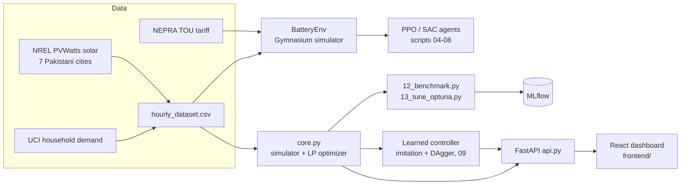

# Smart Battery Optimizer

Hour-by-hour scheduling of a home solar battery for Pakistani households: when to store solar, when to buy cheap
off-peak power, when to run the house from the battery, and how much charge to hold back for load-shedding.

The project compares reinforcement learning (PPO, SAC), rule-based controllers, an hourly-replanning optimizer
(model predictive control, MPC) and a neural network trained to imitate it. All of them run in one custom Gymnasium
simulator built on real data. A FastAPI backend and a React dashboard make any scenario explorable.

## Results (13 held-out weeks, Faisalabad, 5 kW panels, 10 kWh / 3 kW battery)

| Controller | Avg. weekly cost (PKR) | vs self-use rule | Weeks cheaper than self-use |
|---|---:|---:|---:|
| No battery | 3,621 | −68.9% | 0/13 |
| Self-use rule (installer default) | 2,144 | — | — |
| Peak-aware rule | 2,358 | −10.0% | 4/13 |
| PPO, residual on self-use (RL) | 2,483 | −15.8% | 1/13 |
| SAC, residual on self-use (RL) | 2,593 | −21.0% | 1/13 |
| Learned controller (imitates MPC, DAgger) | 2,067 | **+3.6%** | 7/13 |
| MPC, typical-day demand forecast | 2,075 | **+3.2%** | 9/13 |
| MPC, perfect forecast | 1,991 | +7.1% | 9/13 |
| Oracle (perfect knowledge of the whole week) | 1,972 | +8.0% | 13/13 |

**Load-shedding** (grid off 08–10 and 19–21 daily): the optimizer knows the published schedule and keeps charge in
reserve, cutting unmet demand from 14.0 kWh/week (self-use rule) to 4.0 kWh/week.

What this means:

- A simple self-use rule is already within 8% of the best possible cost under the NEPRA time-of-use tariff.
- PPO and SAC could not find the last few percent through RL reward noise and ended up worse than the rule they started from.
- Solving the problem directly as a linear program every hour gets most of the ceiling with no training. A small
  network trained to copy it (DAgger) beats the rule in 7 of 13 weeks.

Reproduce with `python 12_benchmark.py` (writes `data/processed/benchmark.json` and logs every run to MLflow).

## Architecture



| Path | What it is |
|---|---|
| `env/battery_env.py` | Gymnasium environment: 10 kWh battery, 3 kW inverter, 95% efficiency, 10% minimum charge, TOU or wholesale pricing |
| `core.py` | Fast simulator with outages and battery wear, plus the linear-program optimizer (MPC) and the oracle |
| `agent.py` | Loads the learned controller (`models/imitation_mpc_v7.pt`) |
| `api.py` | FastAPI backend; also serves the built dashboard |
| `frontend/` | React 19 + TypeScript + Vite + Tailwind CSS + Recharts dashboard |
| `00`–`13_*.py` | The project phases in order: setup, data, environment, PPO/SAC, MPC + imitation, benchmark, tuning |
| `tests/` | pytest suite for the simulator and the API |

## Quick start

### Docker (one command)

```bash
docker build -t smart-battery-optimizer .
docker run -p 8000:8000 smart-battery-optimizer
```

Open http://localhost:8000.

### Local development

```bash
python -m venv venv
venv\Scripts\activate            # macOS/Linux: source venv/bin/activate
pip install -r requirements-dev.txt
uvicorn api:app --reload --port 8000
```

In a second terminal:

```bash
cd frontend
npm install
npm run dev
```

Open http://localhost:5173 (the dev server proxies `/api` to the backend). For a production build, run
`npm run build`. FastAPI then serves `frontend/dist` itself at http://localhost:8000.

## The dashboard

The app is a single planner page: pick a city, week, panel and battery size, household demand, tariff (NEPRA preset or custom rates and
  peak hours), a load-shedding schedule and a battery wear cost. It shows the weekly saving, a cost comparison of all
  strategies, the optimizer's 24-hour schedule, and hour-by-hour solar, demand, battery level and battery power
  (charts or table), plus a per-day cost table.

Light and dark themes; works down to phone width.

## API

| Method | Path | Purpose |
|---|---|---|
| GET | `/api/health` | Liveness, and whether the learned model is loaded |
| GET | `/api/config` | Cities, weeks, default tariff, outage presets, defaults |
| POST | `/api/optimize` | Run one scenario for one week (about 2 s) |

Interactive docs: http://localhost:8000/docs. Example:

```bash
curl -X POST http://localhost:8000/api/optimize -H "Content-Type: application/json" -d "{\"location\": \"karachi\", \"battery_kwh\": 15, \"outage_hours\": [19, 20]}"
```

## Experiments

```bash
python 12_benchmark.py      # all controllers x 3 scenarios on held-out weeks -> MLflow + benchmark.json
python 13_tune_optuna.py    # Optuna: optimizer horizon and end-of-window value, on training weeks
mlflow ui --backend-store-uri sqlite:///mlflow.db   # browse runs at http://localhost:5000
tensorboard --logdir runs   # PPO/SAC training curves
```

Optuna (25 trials) found that the hand-picked optimizer settings were already near-optimal: the best trial
(72 h horizon) saved 6 PKR/week on the tuning weeks and nothing on held-out weeks (2,075 PKR/week either way), so the
48 h default was kept.

## Data

| Source | Used for |
|---|---|
| [UCI Individual Household Electric Power Consumption](https://archive.ics.uci.edu/dataset/235/individual+household+electric+power+consumption) | Hourly household demand (2009) |
| [NREL PVWatts v8](https://developer.nrel.gov/docs/solar/pvwatts/) | Typical-year hourly output of a 5 kW system: Faisalabad, Lahore, Karachi, Islamabad, Peshawar, Quetta, Multan |
| [Open Power System Data](https://data.open-power-system-data.org/time_series/) | Wholesale prices (early experiments only) |
| NEPRA time-of-use tariff | Peak 46.85, off-peak 34.53, export 11 PKR/kWh, peak 18:00–22:00 |

The two large raw files (`household_power_consumption.txt`, `time_series_60min_singleindex.csv`) are not in git.
Download them from the links above into `data/raw/` and run `02_build_dataset.py` to rebuild the dataset.
`11_fetch_locations.py` re-downloads the city solar profiles (set `NREL_API_KEY`, or the rate-limited demo key is used).

## Tests and CI

```bash
pytest -q
```

GitHub Actions (`.github/workflows/ci.yml`) runs the tests, lints and builds the frontend, then builds the Docker
image and smoke-tests it on every push and pull request.

## Limitations

- Solar is a typical year, not live weather; demand is one real household, scaled.
- The optimizer forecasts future demand with an average day. It never sees the future exactly.
- Load-shedding is a fixed daily schedule; unannounced outages are not modelled.
- The learned controller is only valid for the system it was trained on (Faisalabad, 5 kW, 10 kWh / 3 kW, NEPRA TOU, no outages). The dashboard hides it otherwise.
