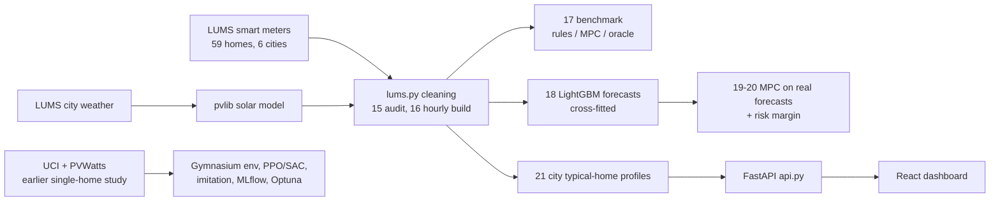

# Smart Battery Optimizer

Hour-by-hour scheduling of a home solar battery for Pakistani households: when to store solar, when to buy cheap
off-peak power, when to run the house from the battery, and how much charge to hold back for load-shedding.

The project compares reinforcement learning (PPO, SAC), rule-based controllers, an hourly-replanning optimizer
(model predictive control, MPC) and a neural network trained to imitate it. All of them run in one custom Gymnasium
simulator built on real data. A FastAPI backend and a React dashboard make any scenario explorable.

## Results on 58 real Pakistani homes

Data: LUMS Energy Institute smart meters (REWD-P), 59 homes in Lahore, Multan, Peshawar, Karachi, Islamabad and
Skardu, 1-minute readings, Nov 2023 - Oct 2024; solar modelled with pvlib from each city's measured radiation and
checked against two homes with metered rooftop panels (hourly r = 0.92 and 0.78). Each home gets a system sized like
an installer would (panels cover yearly use, battery about half a day's use), NEPRA time-of-use prices.
2,539 complete home-weeks; intervals are 95% bootstrap intervals over homes.

| Controller | Saves vs no battery (median home) | Extra vs self-use rule, % of no-battery bill | PKR/yr | Beats rule in |
|---|---:|---:|---:|---:|
| Self-use rule (installer default) | 54.3% | — | — | — |
| Peak-aware rule | 30.6% | −21.5% [−24.5, −18.8] | −20,913 | 0/58 homes |
| Optimizer, perfect 48 h forecast | 56.7% | **+2.5%** [+2.0, +3.0] | **+2,199** | **58/58** |
| Oracle (perfect knowledge of the week) | 57.8% | +3.6% [+3.2, +4.1] | +3,182 | 58/58 |
| Optimizer, persistence forecast | 53.9% | −0.9% [−1.4, −0.5] | −683 | 14/58 |
| Optimizer, LightGBM forecast | 53.5% | −0.8% [−1.1, −0.5] | −626 | 13/58 |
| Optimizer, persistence + tuned risk margin* | — | −0.8% [−1.2, −0.4] | −439 | 6/29 |

\* risk margin tuned on 30 homes, reported on the 29 others.

What this means:

- **The headroom is small.** A self-use battery already cuts the median bill by 54%; perfect knowledge of the whole
  week adds only 3.6% of the bill (about 3,200 PKR/yr).
- **The optimizer's logic works:** with a perfect forecast it beats the rule in every one of 58 homes and captures
  73% of the headroom.
- **Real forecasts erase the gain.** Household demand is erratic; with forecasts built only from the past, the
  optimizer falls slightly but significantly below the rule. Its extra trick, buying cheap off-peak power for the
  evening peak, earns about 7.7 PKR/kWh, while a forecast mistake costs about 23 PKR/kWh (energy bought, then
  exported at 11 PKR), so errors outweigh the wins.
- **Lower forecast error did not mean better decisions.** A LightGBM forecaster (cross-fitted, never trained on the
  home it predicts) beat persistence by 14% in MAE but made control worse: it under-predicted demand by about 8%
  (64% in Skardu). Switching to a mean (L2) loss with online recalibration removed the bias; the optimizer then
  matched persistence but still did not beat the rule.
- **Where optimization clearly helps is load-shedding:** knowing the published schedule, it keeps charge in reserve
  (unmet demand 14.0 to 4.0 kWh/week in the earlier single-home study).

Reproduce: `14_fetch_lums.py` (download), `15_audit_lums.py` (data audit), `16_build_lums_dataset.py`,
`17_benchmark_homes.py`, `18_forecast.py`, `19_benchmark_forecast.py`, `20_robust_mpc.py`.

### Earlier study: one household, RL vs optimization

Before the real Pakistani data, a single household (UCI demand, PVWatts solar for Faisalabad) on 13 held-out weeks:
PPO and SAC agents trained as corrections on top of the self-use rule ended up 16-21% worse than the rule; an hourly
linear-program optimizer beat it by 3-7%; a network imitating it with DAgger beat it in 7 of 13 weeks
(scripts `04`-`13`, results in `data/processed/benchmark.json`).

## Architecture



| Path | What it is |
|---|---|
| `env/battery_env.py` | Gymnasium environment: 10 kWh battery, 3 kW inverter, 95% efficiency, 10% minimum charge, TOU or wholesale pricing |
| `core.py` | Fast simulator with outages and battery wear, plus the linear-program optimizer (MPC) and the oracle |
| `lums.py` | Loads and cleans the LUMS data (inconsistent columns, duplicate and truncated timestamps) and the pvlib solar model |
| `api.py` | FastAPI backend; also serves the built dashboard |
| `frontend/` | React 19 + TypeScript + Vite + Tailwind CSS + Recharts dashboard |
| `00`–`13_*.py` | Earlier single-home study: setup, data, environment, PPO/SAC, MPC + imitation, benchmark, tuning |
| `14`–`21_*.py` | Real Pakistani homes: download, audit, dataset, benchmark, forecasting, robust MPC, app profiles |
| `tests/` | pytest suite for the simulator and the API |

## Quick start

### Docker (one command)

```bash
docker build -t smart-battery-optimizer .
docker run -p 8000:8000 smart-battery-optimizer
```

Open http://localhost:8000.

### Local development

```bash
python -m venv venv
venv\Scripts\activate            # macOS/Linux: source venv/bin/activate
pip install -r requirements-dev.txt
uvicorn api:app --reload --port 8000
```

In a second terminal:

```bash
cd frontend
npm install
npm run dev
```

Open http://localhost:5173 (the dev server proxies `/api` to the backend). For a production build, run
`npm run build`. FastAPI then serves `frontend/dist` itself at http://localhost:8000.

## The dashboard

The app is a single planner page: pick a city, week (Nov 2023 - Oct 2024), panel and battery size, daily consumption, tariff (NEPRA preset or custom rates and
  peak hours), a load-shedding schedule and a battery wear cost. It shows the weekly saving, a cost comparison of all
  strategies, the optimizer's 24-hour schedule, and hour-by-hour solar, demand, battery level and battery power
  (charts or table), plus a per-day cost table.

Demand is each city's typical-home profile (the hourly average over the city's LUMS homes, each normalised to its own
yearly mean, so no individual home's readings ship with the app), scaled to the daily consumption you enter. The
smart schedule only uses past data: it forecasts the next 48 h from the last 24-48 h and plans with the tuned risk
margin.

Light and dark themes; works down to phone width.

## API

| Method | Path | Purpose |
|---|---|---|
| GET | `/api/health` | Liveness |
| GET | `/api/config` | Cities, weeks, default tariff, outage presets, defaults |
| POST | `/api/optimize` | Run one scenario for one week (about 2 s) |

Interactive docs: http://localhost:8000/docs. Example:

```bash
curl -X POST http://localhost:8000/api/optimize -H "Content-Type: application/json" -d "{\"location\": \"karachi\", \"battery_kwh\": 15, \"outage_hours\": [19, 20]}"
```

## Experiments

```bash
python 12_benchmark.py      # all controllers x 3 scenarios on held-out weeks -> MLflow + benchmark.json
python 13_tune_optuna.py    # Optuna: optimizer horizon and end-of-window value, on training weeks
mlflow ui --backend-store-uri sqlite:///mlflow.db   # browse runs at http://localhost:5000
tensorboard --logdir runs   # PPO/SAC training curves
```

Optuna (25 trials) found that the hand-picked optimizer settings were already near-optimal: the best trial
(72 h horizon) saved 6 PKR/week on the tuning weeks and nothing on held-out weeks (2,075 PKR/week either way), so the
48 h default was kept.

## Data

| Source | Used for |
|---|---|
| [LUMS Energy Institute, Residential Energy and Weather Data - Pakistan](https://lei.lums.edu.pk/datasets/residential-energy-and-weather-data-pakistan.html) | 59 homes' 1-minute smart-meter data and hourly city weather (main study and app) |
| [UCI Individual Household Electric Power Consumption](https://archive.ics.uci.edu/dataset/235/individual+household+electric+power+consumption) | Household demand in the earlier single-home study |
| [NREL PVWatts v8](https://developer.nrel.gov/docs/solar/pvwatts/) | Typical-year solar in the earlier study |
| NEPRA time-of-use tariff | Peak 46.85, off-peak 34.53, export 11 PKR/kWh, peak 18:00-22:00 |

The LUMS page states no license, so neither its raw files nor per-home derived data are in git: run
`14_fetch_lums.py` to download it. The app ships only city-level averages (`data/app/`). Please cite the LUMS Energy
Institute when using the data. The large UCI and OPSD files are also not in git; download them into `data/raw/`
and run `02_build_dataset.py` for the earlier study.

## Tests and CI

```bash
pytest -q
```

GitHub Actions (`.github/workflows/ci.yml`) runs the tests, lints and builds the frontend, then builds the Docker
image and smoke-tests it on every push and pull request.

## Limitations

- One year of data, 58 homes; Skardu homes have much missing data.
- Solar comes from city-level weather stations, not each roof (daily error 16-29% against the two metered roofs).
- Weather "forecasts" for the forecaster are measured values plus typical forecast noise, not archived forecasts.
- Load-shedding is a fixed daily schedule; the real outages in the meter data were not reconstructed.
- System sizes follow one installer-style rule; other battery sizes may change the headroom.
